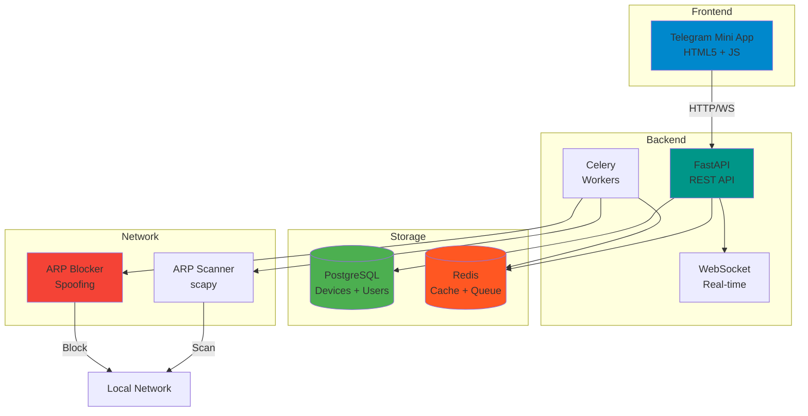
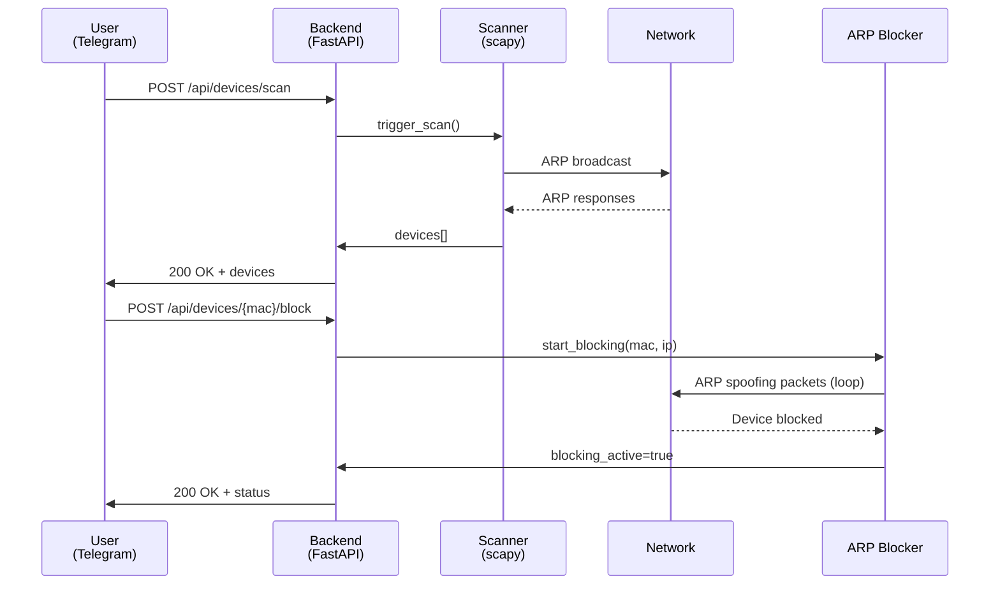

# 📸 SCREENSHOT SPECIFICATIONS - Control de Red v9

**Objetivo:** Assets visuales para README, Reddit, HN, Video  
**Total:** 6 screenshots core + 2 opcionales  
**Timeline:** Producción mañana (sábado)

---

## 🎯 SPECS TÉCNICAS GLOBALES

**Resolución base:** 1920x1080 (Full HD)  
**Formato:** PNG (sin compresión)  
**Color depth:** 24-bit RGB  
**Tools:** Greenshot / Snagit / macOS Screenshot  
**Annotations:** Minimal, solo highlights críticos  
**Upload:** Imgur album (público, sin login)

---

## 📋 SCREENSHOTS REQUERIDOS

### **#1: Dashboard Overview (PRIORIDAD ALTA)**

**Contexto:** Hero image README, Reddit post thumbnail base

**Contenido:**
```yaml
Dispositivos visible: 8 total
  - 3 bloqueados (rojo): 
      * "iPhone Vecino" (Apple)
      * "Smart TV Samsung"
      * "Xbox Series X"
  
  - 5 activos (verde):
      * "Router BOSQUE_DE_ARCE" (gateway)
      * "MacBook Pro Héctor"
      * "Google Nest Mini"
      * "Laptop Dell"
      * "Raspberry Pi 4"

Network info header:
  - SSID: BOSQUE_DE_ARCE_5G
  - Gateway: 192.168.1.1
  - Total: 8 devices
  - Blocked: 3 devices

Timestamp: Visible, real (tipo "Last scan: hace 5 seg")
```

**Layout:**
- Header con network name grande
- Grid 2 columnas o lista vertical
- Status colors visibles (rojo/verde)
- Icons dispositivos (si tienes)

**Annotations:**
- Red circle → "Dispositivo bloqueado" (uno de los rojos)
- Green arrow → "Block button" en device card

**Crop:**
- Eliminar browser chrome (URL bar, bookmarks)
- Focus: Contenido útil solamente
- Aspect ratio: 16:9 preservado

**Mock data file:** `~/control-red-v9-dev/mock_devices.json`
```json
[
  {
    "mac": "aa:bb:cc:dd:ee:01",
    "ip": "192.168.1.100",
    "vendor": "Apple Inc.",
    "device_type": "phone",
    "custom_name": "iPhone Vecino",
    "is_blocked": true
  },
  ...
]
```

**Expected output:** `dashboard-overview-1920x1080.png` (~500KB)

---

### **#2: Telegram Bot Welcome (PRIORIDAD ALTA)**

**Contexto:** README Quick Start, Reddit demo, Video Scene 5

**Contenido:**
```yaml
Device: iPhone mockup (usar mockuphone.com)
Screen: Telegram chat @Mi_red_control_bot

Chat history:
  1. User: /start
  2. Bot: [Welcome message completo con HTML]
  3. Inline keyboard visible:
     - [🚀 Setup Backend] [📖 Ver Docs]
     - [💬 Ayuda]        [ℹ️ Acerca de]

UI clean:
  - Full battery
  - WiFi icon
  - Time: 10:30 o similar
  - No otras notificaciones
```

**Tools:**
- Real screenshot en tu iPhone/Android
- O mockup: https://mockuphone.com/device/iphone13pro
- Telegram debe estar en español

**Annotations:**
- Ninguna (clean screenshot)

**Crop:**
- Phone mockup completo (con bezel)
- O crop solo pantalla si prefieres

**Expected output:** `telegram-welcome-iphone.png` (~800KB)

---

### **#3: Device Detail Modal (PRIORIDAD MEDIA)**

**Contexto:** README features, technical detail

**Contenido:**
```yaml
Modal/Card ampliado de 1 dispositivo:

Device: "Smart TV Samsung"
MAC: a1:b2:c3:d4:e5:f6
IP: 192.168.1.105
Vendor: Samsung Electronics
Type: TV
Status: 🔴 BLOCKED
First seen: 2026-10-14 08:30
Last seen: 2026-10-16 15:45

Buttons:
  - [⚫ Unblock] (prominente)
  - [✏️ Rename]
  - [🗑️ Delete]

Timeline (últimos 3 eventos):
  - 15:45 - Blocked by admin
  - 14:20 - Connected
  - 08:30 - First seen
```

**Layout:**
- Modal centrado sobre dashboard blur
- Info organizada (labels bold)
- Timeline como lista vertical

**Annotations:**
- Highlight MAC address (útil para docs técnicos)

**Expected output:** `device-detail-modal-1920x1080.png`

---

### **#4: Railway Dashboard Deployed (PRIORIDAD ALTA)**

**Contexto:** README tutorial, RAILWAY_DEPLOY.md, Video Scene 4

**Contenido:**
```yaml
Railway project view:

Services visible:
  - control-red-v9-dev (verde, deployed)
  - postgres (verde, running)
  - redis (verde, running)

Control-red-v9-dev panel:
  - Status: ✅ Deployed
  - URL: https://control-red-production-xxxx.up.railway.app
  - Last deploy: xx mins ago
  - Metrics visible (CPU, RAM graph)

Sidebar:
  - Deployments tab selected
  - Logs visible (últimas 10 líneas)
```

**Timing:**
- Capturar DESPUÉS de tu deploy real (usar tu Railway)

**Annotations:**
- Green arrow → "Generate Domain" button
- Red box → Deployed URL (highlight)

**Expected output:** `railway-deployed-1920x1080.png`

---

### **#5: Architecture Diagram (PRIORIDAD MEDIA)**

**Contexto:** README, docs técnicos, HN comments

**Contenido:**


**Tool:** 
- Mermaid Live Editor: https://mermaid.live/
- Paste código → Export PNG (2x scale)

**O alternativa:**
- Figma: Dibujar manual con iconos
- Excalidraw: https://excalidraw.com/

**Style:**
- Dark background (#1a1a1a)
- Colores pasteles tech (azul, verde, naranja)
- Labels claros (sans-serif 16px+)

**Expected output:** `architecture-diagram-dark-1920x1080.png`

---

### **#6: Workflow Diagram - Scan + Block (PRIORIDAD BAJA)**

**Contexto:** Docs técnicos, how it works

**Contenido:**


**Expected output:** `workflow-scan-block-sequence-1920x1080.png`

---

## 📸 SCREENSHOTS OPCIONALES (Si tiempo sobra)

### **#7: Railway Build Logs**

**Contenido:**
```
Railway deployment logs:
[Building...]
✓ Dockerfile detected
✓ Installing dependencies
✓ Running tests
✓ Build successful
[Deploying...]
✓ Service started
✓ Health check passed
```

### **#8: Bot Commands Help Screen**

**Contenido:**
Telegram chat mostrando `/help` response completo

---

## 🎨 STYLE GUIDE

### **Colors:**
```yaml
Blocked devices: #f44336 (red 500)
Active devices: #4CAF50 (green 500)
Background dark: #1a1a1a
Background light: #ffffff
Text primary: #212121
Text secondary: #757575
Accent: #0088cc (Telegram blue)
```

### **Typography:**
```yaml
Primary font: Inter, SF Pro, Roboto
Code font: JetBrains Mono, Fira Code
Sizes: 
  - Headers: 24-32px
  - Body: 14-16px
  - Labels: 12-14px
```

### **Annotations:**
```yaml
Tool: Snagit arrows/boxes
Arrow color: #ff9800 (orange)
Box color: Transparent fill, #f44336 border
Text: White on semi-transparent black (#000000aa)
```

---

## 📤 ENTREGA

### **Naming convention:**
```
{component}-{variant}-{resolution}.png

Ejemplos:
  dashboard-overview-1920x1080.png
  telegram-welcome-iphone.png
  device-detail-modal-1920x1080.png
  railway-deployed-1920x1080.png
  architecture-diagram-dark-1920x1080.png
  workflow-scan-block-sequence-1920x1080.png
```

### **Upload Imgur:**

1. Ve a: https://imgur.com/upload
2. Drag & drop los 6 PNGs
3. Click "Start Upload"
4. Cuando termine → "Create album"
5. Title: "Control de Red v9 - Screenshots"
6. Description: "WiFi control via Telegram - Demo assets"
7. Visibility: Public
8. Copy album URL: `https://imgur.com/a/{album_id}`

### **Update docs con URLs:**

```markdown
README.md:


REDDIT_POST.md:
Screenshots: [Imgur album](https://imgur.com/a/{album_id})

VIDEO_SCRIPT.md:
ESCENA 1: Import https://i.imgur.com/{id}.png
```

---

## ⏱️ ESTIMADO PRODUCCIÓN

| Screenshot | Tiempo | Dificultad |
|------------|--------|-----------|
| #1 Dashboard | 15 min | Media (mock data) |
| #2 Telegram | 10 min | Baja (real screenshot) |
| #3 Device Detail | 15 min | Media (trigger modal) |
| #4 Railway | 5 min | Baja (ya deployed) |
| #5 Architecture | 20 min | Media (Mermaid/Figma) |
| #6 Workflow | 15 min | Media (Mermaid) |
| Upload + link | 10 min | Baja |

**TOTAL: ~90 minutos mañana**

---

## ✅ CALIDAD CHECKLIST

Antes de upload, revisar:

- [ ] Resolución correcta (1920x1080)
- [ ] Sin artifacts de compresión (PNG lossless)
- [ ] Texto legible (zoom 100%)
- [ ] Sin info sensible (passwords, tokens reales)
- [ ] Browser chrome removido (donde aplica)
- [ ] Annotations sutiles (no invasivas)
- [ ] Colors consistentes (mismo palette)
- [ ] Mock data realista (no "test test test")

---

**Documento listo para ejecución mañana.**  
**Tiempo estimado: 90 min → Output 6 assets production-ready**
